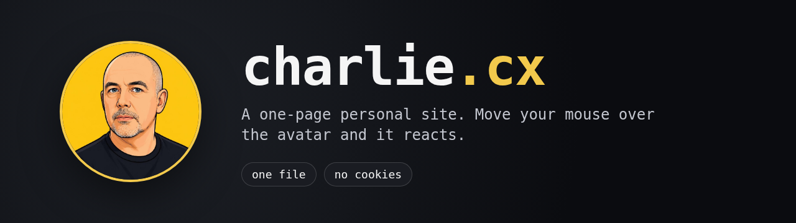
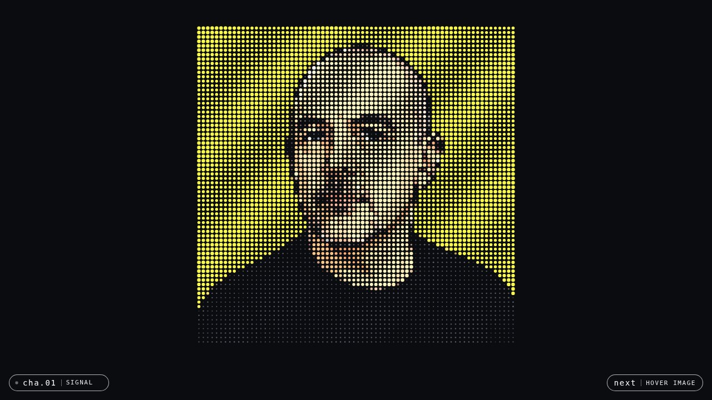
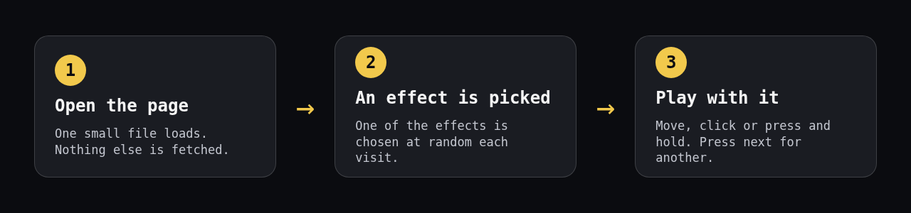
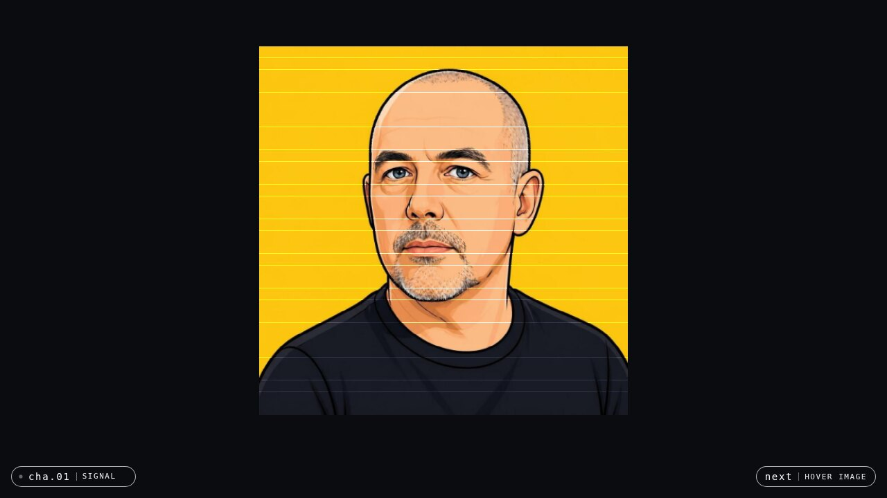
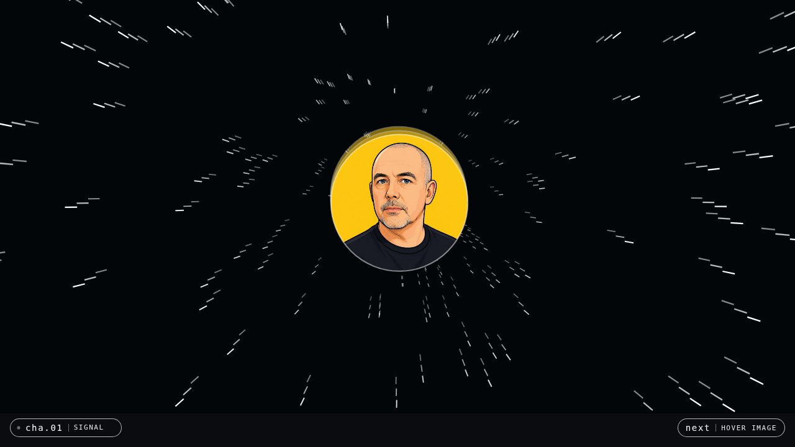

This is the source of [charlie.cx](https://charlie.cx), a one-page personal website. It shows an avatar full screen and lets you play with it.

The whole site is one HTML file. It has no cookies, no analytics and no outside requests, so it loads fast.

## How it works

Each visit picks one of 30 effects at random. Press Next or reload the page for a different one.

## The effects

<table>
<tr>
<td width="50%"> <b>Glitch</b></td>
<td width="50%"> <b>Warp</b></td>
</tr>
</table>

Most effects react to the mouse or a finger. Some also respond to a click or to pressing and holding.

## What it does

- Bounce, particles, ripple, tilt, mosaic, magnifier, kaleidoscope and frost.
- Orbit, pixelate, glitch, ascii, halftone, warp, swirl and spotlight.
- Shatter, CRT, wave, cube, gravity, snow globe, trail and tunnel.
- A small "next" pill in the bottom right, in line with the WhatsApp and Signal tag, moves on to the next effect. Its second part changes between "hover image" (on a laptop) or "touch image" (on a phone or tablet) and "for effect", so it reads "next, touch image" and then "next, for effect".
- Shows the WhatsApp and Signal tag in the bottom left.
- Works with a mouse or by touch, on any screen size.
- Uses the avatar as the page icon.

## Settings

There are none. The site stores nothing. The address can end in a number from 1 to 30 to pick an effect, for example `charlie.cx/#11`.

## Where your data lives

Nowhere. The page stores nothing and sends nothing. GitHub Pages serves the file and keeps its own standard server logs.

## Security

There are no forms, accounts or scripts from other sites. To report a problem, see [SECURITY.md](SECURITY.md).

## Building it yourself

There is no build step. Download `index.html` and open it in a browser. To host your own copy, put the file in a repository, switch on GitHub Pages, and replace the contents of `CNAME` with your own domain or delete the file.

## Contributing

See [CONTRIBUTING.md](CONTRIBUTING.md).

## Licence

Released under the GNU General Public Licence, version 3 or any later version. The full text is in [LICENSE](LICENSE). Changes are listed in [CHANGELOG.md](CHANGELOG.md).

Comments are stripped from the published code to keep it lean.

## Disclaimer

The site is provided as it is, with no warranty of any kind.
